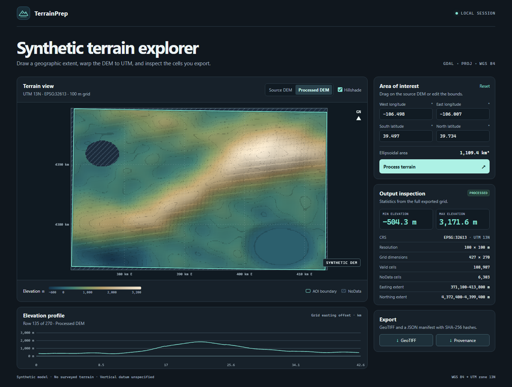
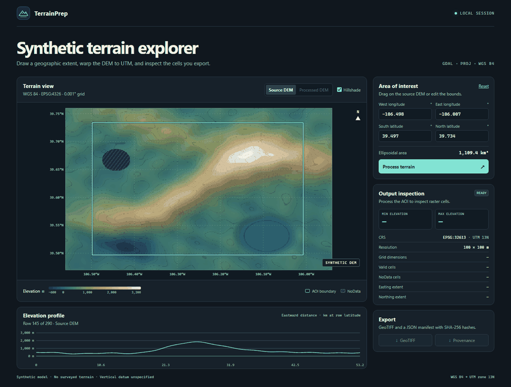
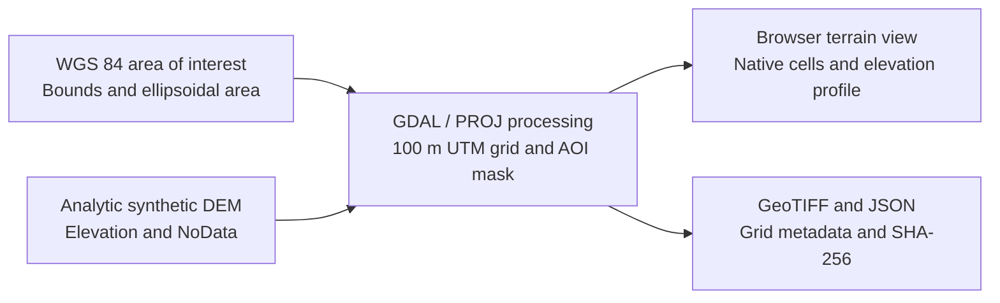
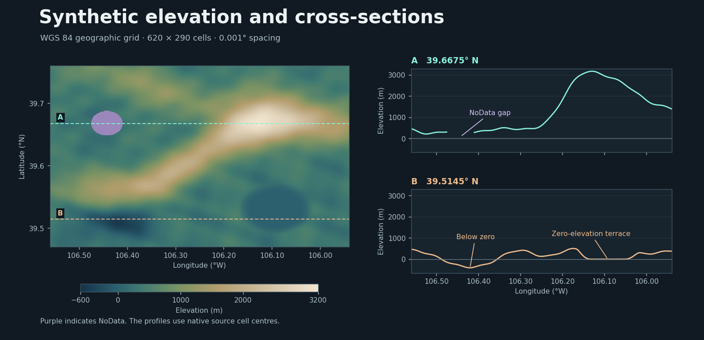
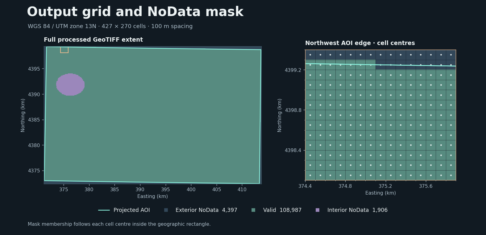

# TerrainPrep

Draw a geographic area of interest, transform a synthetic elevation model onto a reproducible 100 m UTM grid, and inspect the exact cells you export. TerrainPrep pairs a local browser interface with a GeoTIFF and a JSON provenance manifest.

**Why I built this.** My aerospace PhD research involved extensive geospatial analysis, and it highlighted how much specialist tooling can be needed to collect, prepare, and work with geographic data. I wanted terrain-data workflows to feel simpler and more accessible to people who are not GIS experts.

**Portfolio scope.** TerrainPrep is a focused, independently implemented demonstration of the *processing* portion of that broader goal: select an area, reproject a synthetic elevation model, inspect the resulting grid, and export verifiable data. It is not a production terrain downloader or a complete GIS application. My broader, privately developed geospatial software is not included here.

**Python · GDAL via Rasterio · PROJ via pyproj · NumPy · Browser Canvas**



## What this project demonstrates

- **Geospatial engineering:** Transform a WGS 84 area of interest and a synthetic elevation model into an aligned 100 m UTM raster using GDAL/Rasterio and PROJ/pyproj.
- **Numerical integrity:** Preserve negative and zero elevations, handle NoData and geographic boundaries, and verify source-to-output cell values.
- **Interactive scientific software:** Explore terrain and elevation profiles in a local browser, then export GeoTIFF data with a JSON provenance record.
- **Reproducible validation:** Run 19 automated tests and compare documented raster geometry, sample values, and SHA-256 checksums.

## See the workflow

The recording starts with the synthetic source DEM, draws the AOI from southeast to northwest, and shows the reprojected raster and export controls. [Animated browser capture](docs/media/workflow.gif)



The full test suite also passed in the standalone checkout on Windows with 64-bit CPython 3.12.10.

## Run locally

Use 64-bit CPython 3.12 with a browser for a new installation. The pinned Rasterio wheel supplies GDAL and its PROJ data on supported platforms. The pyproj wheel supplies its own PROJ runtime. The end-to-end checks passed on Windows with 64-bit CPython 3.12.10.

```powershell
py -3.12 -m venv .venv
.\.venv\Scripts\python.exe -m pip install -r requirements.txt
.\.venv\Scripts\python.exe -m terrain_demo serve
```

On macOS or Linux, use `python3.12 -m venv .venv` and replace `.\.venv\Scripts\python.exe` with `.venv/bin/python`. Open [http://127.0.0.1:8765/](http://127.0.0.1:8765/) after the server starts. Installation downloads public wheels. The app and its synthetic dataset run locally afterward.

1. Drag a rectangle on **Source DEM**, or edit the four WGS 84 bounds. **Reset** restores the documented example. The ellipsoidal area updates after validation.
2. Select **Process terrain**. Inspect the UTM grid, toggle hillshade, compare the source and output, or follow the middle-row elevation profile. Hatched cells represent NoData.
3. Download **GeoTIFF** and **Provenance**. Keep the JSON with `terrain.tif`. It records the grid parameters and contains SHA-256 hashes of the source pixels, processed pixels, and GeoTIFF.

Run a repeatable export and the test suite from the same Python environment.

```powershell
.\.venv\Scripts\python.exe -m terrain_demo example --out artifacts/example
.\.venv\Scripts\python.exe -m unittest discover -s tests -v
```

## Processing architecture



**Verification:** The scientific tests cover geographic bounds, raster sampling, masking, export metadata, and repeatability.

| Component | Responsibility |
| --- | --- |
| `terrain_demo/model.py` | Validate longitude and latitude bounds, integrate WGS 84 area, generate the source DEM, and describe raster cells. |
| `terrain_demo/terrain.py` | Project the geographic AOI, align and warp the destination grid, mask exterior cells, and serialize GeoTIFF and provenance. |
| `terrain_demo/__main__.py` | Serve an allowlisted loopback API and provide a command-line example export. |
| `terrain_demo/web/` | Draw the native source and processed arrays, AOI, hillshade and profile. Collect bounds and download the two outputs. |
| `tests/` and `scripts/` | Verify numerical and spatial results, exercise the browser offline, and regenerate the portfolio media. |

## Engineering highlights

- **Geographic area.** Input order is longitude then latitude. The AOI edges follow meridians and parallels. Integrating the WGS 84 ellipsoid's surface element accounts for latitude-dependent area and avoids substituting a flat degree grid or four geodesic edges.
- **Synthetic terrain.** The 620 × 290 source raster evaluates Gaussian landforms, sinusoidal folds, a negative basin, and a flat zero terrace on 0.001° cell centres. An elliptical region is assigned the explicit `−9999` NoData sentinel. These cases exercise the same raster code paths as conventional elevation data.
- **Projection and alignment.** GDAL warps the source with nearest-neighbour sampling onto a north-up EPSG:32613 lattice anchored at `(0 m, 0 m)`. The densified AOI envelope snaps outward to whole 100 m edges. Inverse-projected output cell centres determine AOI membership independently of the bounding envelope.
- **Cell integrity.** Valid `0 m` and negative samples survive the warp. The internal NoData hole and the area beyond the geographic selection remain missing. The browser receives the same Float32 values exported to GeoTIFF. Colour and hillshade affect rendering only.
- **Reproducibility.** The manifest records bounds, area, grid geometry, software versions, resampling, NoData counts, and SHA-256 checksums of the source pixels, output pixels and GeoTIFF. The default CLI example produces the same bytes on repeated runs in the tested environment.

## Scientific results

| Default AOI or output property | Verified result |
| --- | --- |
| WGS 84 bounds (west, south, east, north) | `−106.498°, 39.497°, −106.007°, 39.734°` |
| WGS 84 rectangular area | 1,109.4431298 km² |
| GeoTIFF grid | 427 × 270 cells, EPSG:32613, 100 × 100 m |
| Projected easting and northing extents | 371,100–413,800 m E and 4,372,400–4,399,400 m N |
| Valid elevation range | −504.303 to 3,171.609 m |
| Valid cells | 108,987 including 4,177 zero and 3,065 negative cells |
| NoData cells | 6,303 including 4,397 exterior and 1,906 interior cells |
| Inverse-coordinate sample check | 110,893 of 110,893 in-AOI cell values agreed, including NoData |
| Independent audit of the default grid | 115,290 of 115,290 cell values agreed, including the masked exterior |



The cross-sections show native source samples. The upper profile breaks at the internal hole. The lower profile traverses both the negative basin and the zero-elevation terrace.



The projected AOI is slightly skewed on the axis-aligned UTM grid. The detail shows the centre-based mask decision where the geographic edge crosses output cells. This figure uses distinct colours for interior and exterior NoData. The application uses one hatch style for both.

**All 19 automated tests passed on CPython 3.12.10.** The inverse-coordinate sampling test shares the synthetic source array, the production AOI mask, and the pyproj inverse transform used for masking. A separate audit used its own projection and mask calculation to verify every cell of the default exported grid. These comparisons support the documented example and its fixed CRS pair. An Edge browser run also exercised reverse dragging, invalid-input recovery, terrain switching, hillshade, both downloads, all-NoData handling, and a 390 px layout with external requests blocked. [Methods, full validation and capture instructions](docs/validation.md)

## Scientific scope

The coordinates locate an invented terrain surface in UTM zone 13N. The demo uses synthetic heights in metres, with an unspecified vertical datum. Source spacing near the example AOI is roughly 86 m east–west and 111 m north–south. The 100 m output lattice sets the raster sampling and export geometry. Its sampling does not improve source accuracy.

Selections must fit the synthetic footprint. Antimeridian crossings and spans over 180° are rejected. A very small AOI or one fully inside the missing-data region may export an all-NoData grid with null elevation extrema. The AOI area describes the ellipsoidal rectangle. The raster footprint and its valid-cell count are separate measurements.

## Attribution and project context

TerrainPrep is an independently authored portfolio demonstration of geospatial and numerical engineering. Terrain, figures and browser captures in this repository were generated from the demonstration's analytic model and local app. [References and third-party notices](THIRD_PARTY.md)
